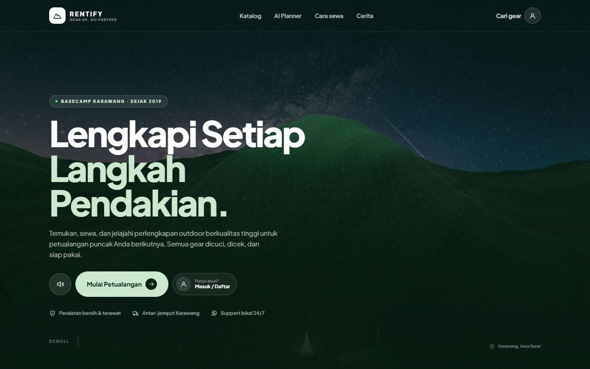
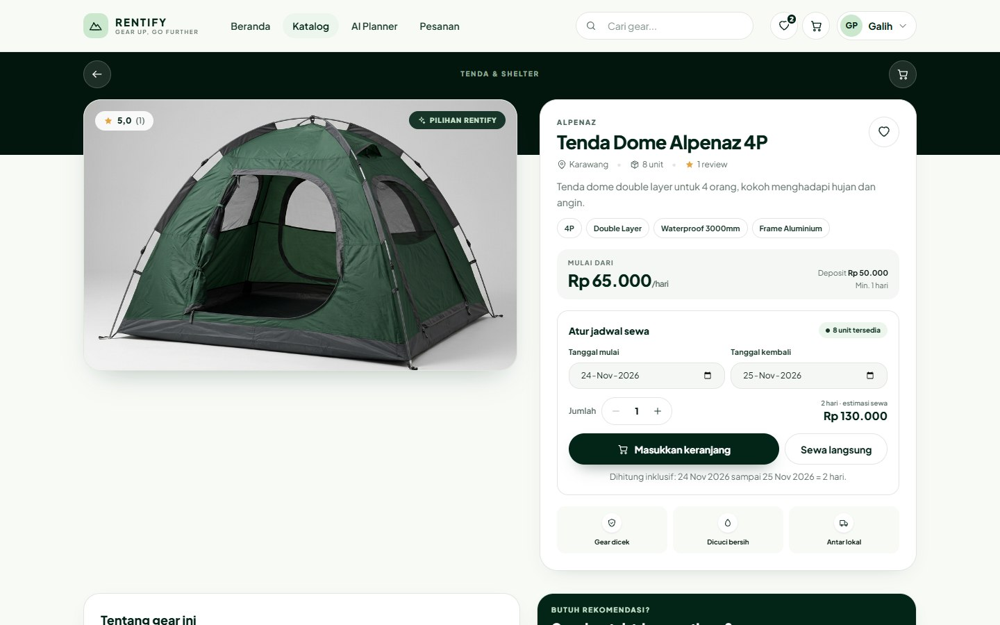
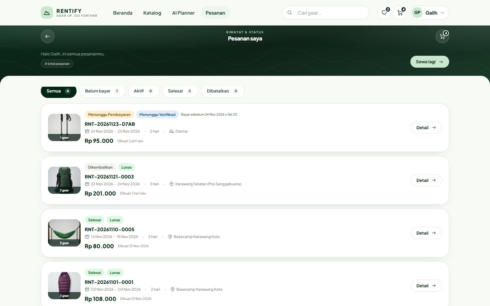
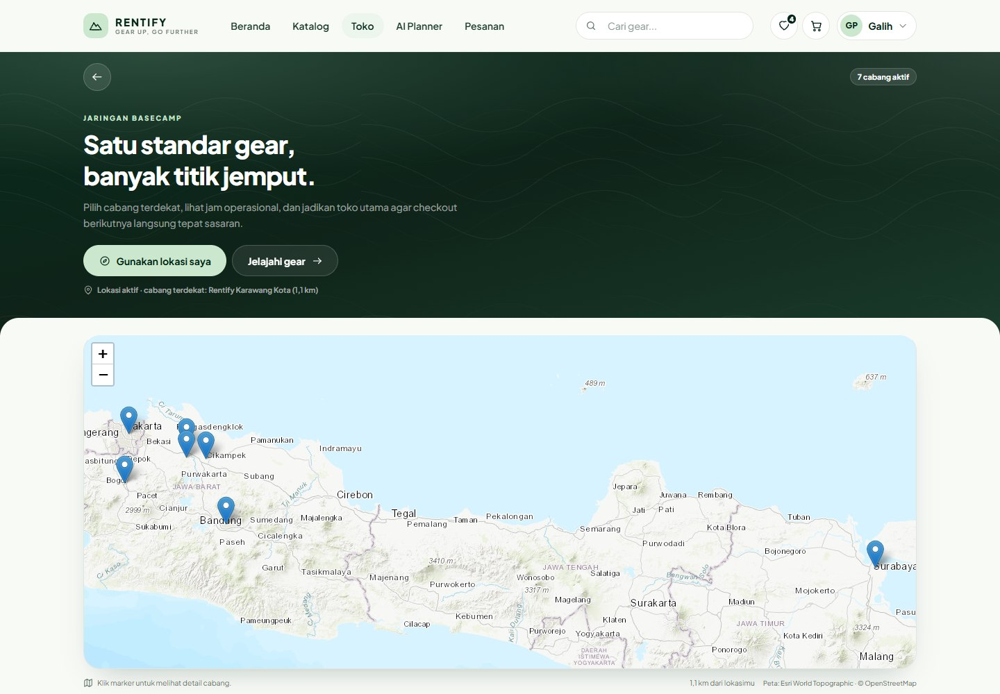
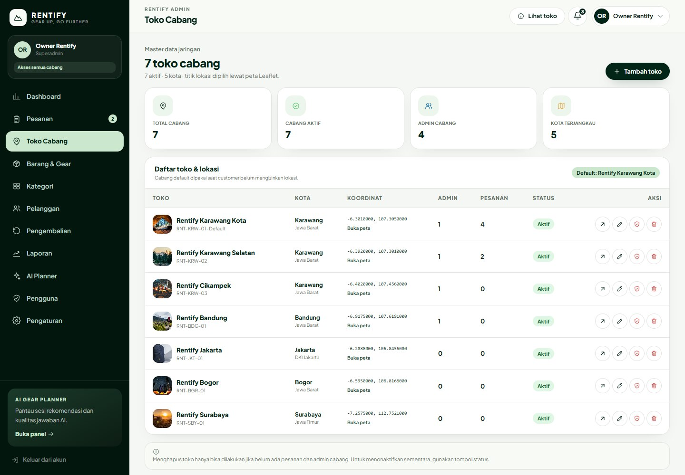
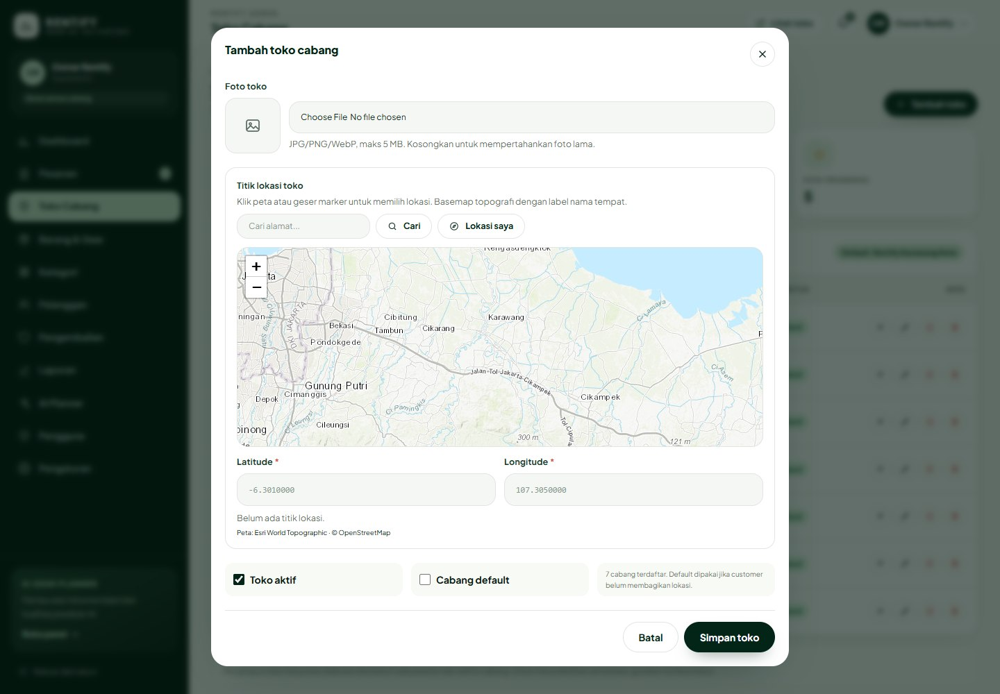
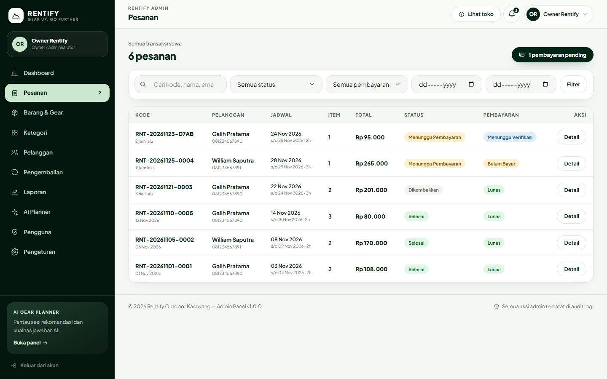
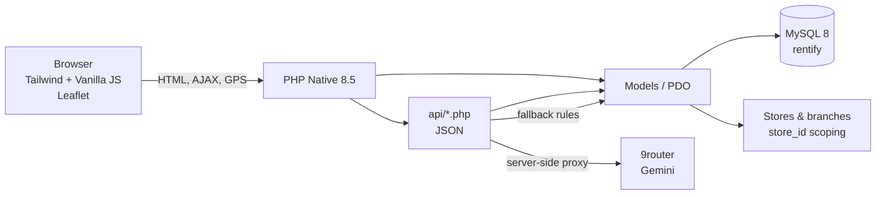

<div align="center">


# Rentify Outdoor Karawang

**Gear Up, Go Further.**

Platform rental perlengkapan outdoor untuk pendaki dan camper di Karawang dan kota lainnya.
**Superadmin** mengelola jaringan cabang, **admin cabang** mengelola tokonya, dan **customer** mendapat rekomendasi cabang terdekat lewat GPS.

<p>
  
  
  
  
  
  
  
</p>

</div>



> **Rentify** adalah aplikasi rental outdoor lengkap: landing page 3D, katalog gear dengan stok real-time, AI Planner, jaringan **7 toko cabang** dengan peta Leaflet, rekomendasi cabang terdekat lewat GPS, checkout AJAX, pembayaran manual, pelacakan pesanan, sampai panel **superadmin** dan admin cabang dengan laporan dan grafik. Dibangun **tanpa framework** — PHP native, PDO, dan JavaScript modular.

---

## Kenapa Rentify?

| | |
|---|---|
| 🤖 **AI yang benar-benar berguna** | AI menyusun daftar gear dari aktivitas, destinasi, durasi, dan jumlah peserta — bukan chatbot. Harga dan stok tetap divalidasi server. |
| 🗺️ **Multi-cabang dari awal** | Superadmin mengelola toko dan titik lokasinya lewat peta Leaflet; admin terikat ke cabang; customer melihat basecamp terdekat dari GPS. |
| 🏕️ **Katalog yang terasa hidup** | Pencarian live saat mengetik, filter dinamis, sortir, dan “muat lebih banyak” tanpa reload atau lompat posisi. Stok, varian, galeri, ulasan, dan estimasi biaya semua real-time. |
| 🧾 **Alur sewa yang jelas** | Keranjang → checkout → pembayaran → verifikasi → pengambilan → pengembalian → review. Semua status terlihat. |
| 📊 **Admin yang siap kerja** | Dashboard metrik, CRUD gear, verifikasi pembayaran, pengembalian, laporan, export CSV, dan monitoring AI. |

---

## Sorotan Fitur

### 🤖 AI Gear Planner

Isi rencana perjalanan, AI memilih gear yang paling relevan dari katalog Rentify.
Setiap item bisa di-include/exclude, diubah jumlahnya, lalu dimasukkan ke keranjang sekaligus.


- Pilihan aktivitas: **Tektok, Camping, Hiking, Ekspedisi**.
- Destinasi Karawang & sekitarnya, tanggal mulai, durasi inklusif, dan jumlah peserta.
- Output berisi **prioritas wajib/opsional**, alasan pemilihan, tips, dan estimasi biaya.
- **Grounded**: AI hanya boleh memilih ID dari kandidat yang dikirim server.
- **Fallback** berbasis aturan kategori jika 9router sedang offline.
- API key AI hanya ada di server (`.env`), tidak pernah dikirim ke browser.

### 🏕️ Beranda & katalog personal


- Sapaan personal, member ID, pesanan mendatang, dan pintasan AI.
- Kategori dan **Top trends** langsung di beranda.
- Katalog dengan filter kategori dinamis, urutan, grid/list, dan pagination AJAX.
- Wishlist dan notifikasi tersedia di seluruh halaman.

### 🔍 Detail gear yang meyakinkan



- Galeri foto, brand, rating, jumlah unit, dan label **Pilihan Rentify**.
- Varian/ukuran, spesifikasi, fitur, dan ulasan pelanggan.
- Cek ketersediaan **real-time** per rentang tanggal.
- Estimasi biaya, deposit, dan durasi otomatis.
- Tombol **Masukkan keranjang** dan **Sewa langsung**.

### 🧾 Checkout tanpa drama


- Ambil di basecamp atau antar ke lokasi (area Karawang).
- Ringkasan subtotal, deposit, biaya antar, dan total transparan.
- Tanggal sewa fleksibel dengan perhitungan **2D1N = 2 hari**.
- Stok ditahan sementara agar tidak bentrok dengan penyewa lain.
- Pembayaran transfer bank atau QRIS, lalu unggah bukti.

### 📦 Pesanan yang transparan



- Timeline status dari `pending` sampai `completed`.
- Status pembayaran, batas waktu bayar, dan riwayat verifikasi.
- Kode pengambilan, pembatalan, dan tombol chat admin.
- Review dan rating setelah gear dikembalikan.

### 🗺️ Jaringan toko cabang & lokasi

Satu akun, banyak basecamp. Superadmin mengelola master toko dan titik lokasinya lewat peta Leaflet, sementara customer melihat cabang terdekat berdasarkan lokasi GPS.



- **3 toko di Karawang** (Karawang Kota, Karawang Selatan, Cikampek) plus **Bandung, Jakarta, Bogor, dan Surabaya**.
- Setiap cabang punya kode, alamat, jam operasional, kontak, biaya antar, dan koordinat sendiri.
- Pilih titik lokasi dengan **klik peta, geser marker, cari alamat, atau gunakan lokasi saat ini**.
- Customer dapat mengizinkan lokasi untuk melihat jarak ke setiap cabang dan menjadikan satu toko sebagai **toko utama**.
- Checkout otomatis memakai cabang terpilih; pesanan, pembayaran, pengembalian, dan laporan admin ter-scope per cabang.

<div align="center">
<table>
  <tr>
    <td width="50%">
      
      <p align="center"><sub><b>Master toko</b> — 7 cabang, admin, pesanan, koordinat, dan status.</sub></p>
    </td>
    <td width="50%">
      
      <p align="center"><sub><b>Leaflet picker</b> — klik peta, cari alamat, atau pakai lokasi saat ini.</sub></p>
    </td>
  </tr>
</table>
</div>

**Hierarki role:** `superadmin` (semua cabang & master data) → `admin` (pesanan, pelanggan, pengembalian, laporan cabang) → `customer` (katalog, AI, pesanan sendiri).

### 📊 Panel admin serba bisa


- Metrik pendapatan, pesanan, pelanggan, dan utilisasi stok.
- Grafik tren 8 bulan dan distribusi status pesanan.
- Daftar pesanan terbaru dan pembayaran yang menunggu verifikasi.

<div align="center">
<table>
  <tr>
    <td width="50%">
      
      <p align="center"><sub><b>Manajemen pesanan</b> — filter, detail, verifikasi pembayaran, ubah status.</sub></p>
    </td>
    <td width="50%">
      
      <p align="center"><sub><b>Laporan bisnis</b> — filter tanggal, grafik, gear terlaris, export CSV.</sub></p>
    </td>
  </tr>
</table>
</div>

Superadmin mengelola **gear & varian, kategori, toko cabang, pengguna, pengaturan, dan monitoring AI Planner**. Admin cabang fokus pada **pesanan, pelanggan, pengembalian, dan laporan cabangnya** — semuanya dengan audit log.

---

## Teknologi

| Lapisan | Teknologi |
|---|---|
| Backend | PHP 8.5 native, PDO, arsitektur model/controller sederhana |
| Database | MySQL 8 / MariaDB 10.4+, 26 tabel, prepared statements |
| Frontend | Tailwind CSS v4 (build lokal), JavaScript modular vanilla, Fetch API |
| 3D | Three.js (vendor lokal) untuk landing page |
| Peta | Leaflet 1.9 + basemap topografi Esri World Topographic + data © OpenStreetMap |
| Grafik | Chart.js (vendor lokal) untuk dashboard & laporan |
| AI | 9router OpenAI-compatible API, model `ag/gemini-3.8-flash-medium` |
| Font | Plus Jakarta Sans (self-hosted) |
| Upload | Validasi MIME + ukuran, gambar bukti bayar & avatar |

---

## Arsitektur



- `api/_bootstrap.php` menangani JSON, sesi, dan CSRF untuk semua endpoint non-GET.
- `models/` menyimpan logika bisnis: katalog, keranjang, booking, pembayaran, AI, dan `Store` untuk cabang.
- `includes/` menyediakan layout, navigasi, helper, dan renderer komponen.
- `admin/` adalah panel terpisah dengan guard role dan sidebar yang berubah sesuai `superadmin` / `admin`.
- Setiap query admin memakai `admin_store_id()`; `null` = superadmin (semua cabang), integer = cabang admin.

---

## Mulai Cepat

### 1. Clone & build aset

```bash
git clone https://github.com/anurr23/rentify.git
cd rentify
npm install
npm run build
```

`npm run build` mengompilasi Tailwind dan menyalin Three.js, Chart.js, serta Leaflet ke `assets/vendor/`.

### 2. Siapkan database

```bash
mysql -u root -p -e "CREATE DATABASE rentify CHARACTER SET utf8mb4 COLLATE utf8mb4_unicode_ci;"
mysql -u root -p rentify < database/rentify.sql
mysql -u root -p rentify < database/seed.sql
```

Atau buka `install.php` sekali untuk membuat database, mengimpor data demo, dan menjalankan migrasi multi-cabang otomatis.

Untuk database lama yang sudah berisi data, jalankan migrasi idempoten:

```bash
php database/migrate.php
```

Migrasi menambahkan tabel `stores`, role `superadmin`, relasi `store_id`, 7 cabang contoh, admin cabang, dan memetakan pesanan lama ke cabang default.

### 3. Konfigurasi

Salin `.env.example` menjadi `.env` (tidak di-commit):

```dotenv
APP_ENV=development

# Database
DB_HOST=127.0.0.1
DB_DOCKER_HOST=mysql-server
DB_PORT=3306
DB_NAME=rentify
DB_USER=root
DB_PASSWORD=

# AI / 9router
RENTIFY_AI_KEY=sk-...
RENTIFY_AI_BASE_URL=http://localhost:20128/v1
RENTIFY_AI_DOCKER_BASE_URL=http://host.docker.internal:20128/v1
RENTIFY_AI_MODEL=ag/gemini-3.8-flash-medium
RENTIFY_AI_TIMEOUT=60
```

Semua nilai juga bisa diberikan langsung sebagai environment variable OS/Docker. Prioritas: environment OS/Docker → `.env`.

### 4. Jalankan

```bash
php -S localhost:8000 router.php
```

Buka **http://localhost:8000**.

Atau lewat Apache/Docker:

```bash
docker start mysql-server php8.5-apache
```

Buka **http://localhost/rentify/**.

---

## Akun Demo

| Role | Cabang | Email | Password |
|---|---|---|---|
| Superadmin | Semua cabang | `admin@rentify.id` | `password` |
| Admin Cabang | Karawang Kota | `asep@rentify.id` | `password` |
| Admin Cabang | Karawang Selatan | `dewi@rentify.id` | `password` |
| Admin Cabang | Cikampek | `rizky@rentify.id` | `password` |
| Admin Cabang | Bandung | `dimas@rentify.id` | `password` |
| Admin Cabang | Jakarta | `nadia@rentify.id` | `password` |
| Admin Cabang | Bogor | `bayu@rentify.id` | `password` |
| Admin Cabang | Surabaya | `sinta@rentify.id` | `password` |
| Customer | — | `galih@petualang.id` | `password` |
| Customer | — | `william@petualang.id` | `password` |

Seed berisi **7 toko cabang, 7 admin cabang, 12 kategori, 34 gear, 5 pesanan, pembayaran, review, aktivitas, destinasi, pickup point,** dan pengaturan awal.

---

## Struktur Database

<details>
<summary><b>26 tabel</b> — klik untuk melihat</summary>

| Kelompok | Tabel |
|---|---|
| Jaringan | `stores` (kode, alamat, koordinat, jam, biaya antar, default) |
| Pengguna | `users` (+ `store_id` untuk admin cabang, `preferred_store_id` & lokasi terakhir customer), `remember_tokens`, `password_resets`, `notifications` |
| Katalog | `categories`, `category_filters`, `items`, `item_images`, `item_variants`, `item_filter_values` |
| Perjalanan | `activities`, `destinations`, `activity_gear_rules`, `pickup_points` (+ `store_id`) |
| Transaksi | `bookings` (+ `store_id`), `booking_items`, `booking_status_logs`, `payments` |
| Interaksi | `reviews`, `wishlists` |
| AI | `ai_sessions`, `ai_session_items`, `ai_cache` |
| Sistem | `settings`, `audit_logs` |

</details>

**Relasi cabang:** `users.store_id` (admin), `bookings.store_id` (cabang penyiapan), `pickup_points.store_id`, dan `users.preferred_store_id` (customer).
Satu titik pickup otomatis dibuat/diperbarui setiap kali toko disimpan, sehingga alamat dan koordinat selalu sinkron.

**Durasi sewa dihitung inklusif:** `end_date - start_date + 1`.
Mulai 24 Nov, kembali 25 Nov = **2 hari (2D1N)**.

**Stok tersedia** = stok total/varian − pesanan aktif yang tanggalnya overlap − hold yang belum kedaluwarsa.

---

## API

Semua respons berupa JSON. Request non-GET wajib menyertakan header `X-CSRF-Token` (otomatis oleh `assets/js/app.js`).

<details>
<summary><b>Customer endpoints</b></summary>

| Method | Endpoint | Fungsi |
|---|---|---|
| GET | `/api/items.php` | Filter & pencarian katalog |
| GET | `/api/availability.php` | Cek stok per tanggal |
| GET/POST | `/api/cart.php` | State, add, add_many, update, remove, clear, dates |
| GET/POST | `/api/wishlist.php` | List / toggle wishlist |
| POST | `/api/auth.php` | Login, register, logout |
| GET/POST | `/api/ai_recommend.php` | Meta AI / buat rekomendasi |
| GET/POST | `/api/booking.php` | Detail, quote, create, cancel |
| GET/POST | `/api/payment.php` | Info pembayaran / unggah bukti |
| POST | `/api/review.php` | Kirim review |
| POST | `/api/profile.php` | Update profil / ganti sandi |
| GET/POST | `/api/notifications.php` | List / read / read all |
| GET/POST | `/api/location.php` | Cari cabang terdekat, simpan GPS, set toko utama |

</details>

<details>
<summary><b>Admin endpoints</b></summary>

| Method | Endpoint | Fungsi |
|---|---|---|
| GET | `/api/admin.php?action=store_form&id=` | Form toko + Leaflet picker (superadmin) |
| POST | `/api/admin.php?action=store_save` | Simpan toko, pickup point, dan koordinat |
| POST | `/api/admin.php?action=store_delete` | Hapus toko (jika belum dipakai) |
| POST | `/api/admin.php?action=store_toggle` | Aktif/nonaktifkan cabang |
| GET | `/api/admin.php?action=user_form&id=` | Form pengguna + assignment cabang |
| POST | `/api/admin.php?action=user_save` | Simpan role, cabang, dan status akun |
| GET | `/api/admin.php?action=item_form&id=` | Form gear |
| POST | `/api/admin.php?action=item_save` | Simpan gear & varian |
| POST | `/api/admin.php?action=item_delete` | Hapus gear |
| POST | `/api/admin.php?action=booking_status` | Ubah status pesanan |
| POST | `/api/admin.php?action=payment_verify` | Verifikasi / tolak pembayaran (scoped cabang) |
| POST | `/api/admin.php?action=category_save` | Simpan kategori |
| POST | `/api/admin.php?action=settings_save` | Simpan pengaturan |
| GET | `/admin/laporan.php?export=csv` | Export laporan CSV |

</details>

---

## Keamanan

- Password di-hash dengan `password_hash()` / `password_verify()`.
- Semua query memakai **prepared statements** PDO.
- CSRF token untuk seluruh request non-GET.
- **RBAC berlapis**: `superadmin` untuk master data, `admin` dibatasi `store_id`-nya, `customer` untuk data sendiri.
- Endpoint admin memeriksa kepemilikan `store_id` sebelum mengubah pesanan/pembayaran.
- Upload divalidasi MIME, ekstensi, dan ukuran; nama file di-randomize.
- Geolocation hanya diminta atas aksi/izin user; koordinat disimpan untuk rekomendasi cabang dan tidak dibagikan ke pihak ketiga.
- Folder sensitif (`config/`, `models/`, `includes/`, `database/`, `storage/`, `_legacy_pos/`) diblokir `.htaccess` dan router.
- Audit log untuk aksi admin dan customer.
- Cookie `HttpOnly`, `SameSite=Lax`, dan `Secure` otomatis saat HTTPS/tunnel.
- API key AI tidak pernah masuk ke HTML/JavaScript.

---

## Struktur Folder

<details>
<summary><b>Lihat struktur proyek</b></summary>

```text
rentify/
├── admin/                 Panel admin (11 halaman, termasuk toko.php)
├── api/                   JSON API + _bootstrap.php + location.php
├── assets/
│   ├── css/               Tailwind source & hasil build
│   ├── fonts/             Plus Jakarta Sans
│   ├── img/               Logo, hero, placeholder
│   ├── js/                app, catalog, detail, ai, cart, booking, admin,
│   │                      location, map-stores, admin-stores
│   └── vendor/            three.module.js, chart.umd.js, leaflet/
├── config/                Bootstrap, database, AI
├── database/              Schema, seed, migrate.php
├── docs/screenshots/      Screenshot README
├── includes/              Layout, nav, helper, auth, renderer
├── models/                Model PDO native (termasuk Store.php)
├── storage/logs/          Log aplikasi
├── uploads/               Foto gear, toko, bukti bayar, avatar
├── index.php              Landing Three.js
├── beranda.php            Beranda customer + cabang terdekat
├── katalog.php            Katalog
├── detail.php             Detail gear
├── rekomendasi.php        AI Planner
├── toko.php               Peta & daftar cabang (Leaflet)
├── keranjang.php          Keranjang
├── checkout.php           Checkout + pilih cabang
├── pesanan.php            Daftar pesanan
├── pesanan_detail.php     Detail & pembayaran
├── profil.php             Profil customer
├── wishlist.php           Wishlist
├── install.php            Installer, health check, migrasi
├── router.php             Router PHP built-in server
└── run.ps1                Script server Windows
```

</details>

---

## Pengujian

Yang sudah diuji pada mesin demo:

- Import schema + seed dari database kosong (7 toko, 7 users, 7 pickup, 5 booking).
- Installer end-to-end via database sementara dan migrasi dari schema lama.
- Smoke test seluruh halaman publik, customer, superadmin, admin cabang, dan API.
- E2E: login → katalog → keranjang → checkout → **pilih cabang** → booking → upload bukti → verifikasi admin cabang → ubah status → review.
- **RBAC**: superadmin bisa semua; admin cabang hanya pesanan/pelanggan/cabangnya; akses lintas cabang ditolak 403.
- CRUD toko cabang via Leaflet picker, assignment admin ke cabang, toggle/nonaktif, validasi koordinat.
- Rekomendasi cabang terdekat (Haversine), simpan GPS, toko utama, peta Leaflet + marker user.
- AI sukses via 9router dan fallback saat AI offline.
- CRUD admin: gear, kategori, pengguna, pengaturan, pengembalian.
- Registrasi, profil, ganti kata sandi, wishlist, notifikasi.
- Export CSV per cabang dan tampilan responsif 390 px / 1440 px.

Health check cepat:

```text
http://localhost:8000/install.php
```

---

## Troubleshooting

<details>
<summary><b>CSS tidak muncul / tampilan polos</b></summary>

- Jalankan `npm run build:css`.
- Hard refresh (**Ctrl + Shift + R**).
- Jika lewat tunnel HTTPS, pastikan aplikasi membaca `X-Forwarded-Proto: https`. Versi terbaru sudah mendukung Cloudflare Tunnel, ngrok, dan localtunnel.
- Cek `tailwind.css?v=...` di DevTools → Network harus **200 text/css**.

</details>

<details>
<summary><b>AI Planner bilang "AI sedang tidak bisa dihubungi"</b></summary>

- Pastikan 9router berjalan di `http://localhost:20128`.
- Di Docker, gunakan `http://host.docker.internal:20128/v1`.
- Cek `storage/logs/app.log`.
- Jika AI mati, aplikasi otomatis memakai rekomendasi berbasis aturan.

</details>

<details>
<summary><b>Database belum siap</b></summary>

- Pastikan container `mysql-server` atau MySQL lokal berjalan.
- Cek kredensial di `.env` atau environment variable.
- Buka `install.php` sekali untuk membuat database dan mengimpor seed.

</details>

<details>
<summary><b>Upload gagal</b></summary>

- Pastikan folder `uploads/` writable.
- Format JPG, PNG, atau WebP; maksimal 5 MB (avatar 3 MB).
- Cek `file_uploads`, `upload_max_filesize`, dan `post_max_size`.

</details>

---

<div align="center">

**Rentify Outdoor Karawang** — dibuat dengan PHP native, sedikit AJAX, dan banyak kopi di basecamp.

<sub>Basecamp Karawang, Jawa Barat · 2026</sub>

</div>
